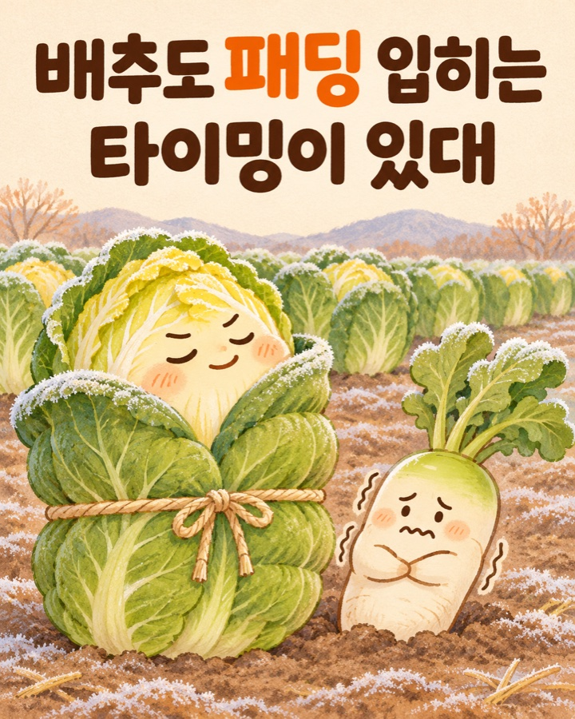

<p align="center">
  
</p>

<p align="center">
  <a href="README.md">한국어</a> · <b>English</b>
</p>

# ssul

**Korean social posts that don't read like AI.**

*ssul* (썰) is Korean slang for a true story you tell your friends. ssul is an agent skill for Claude Code and Codex that writes, polishes, and audits Korean posts for Threads, X, Instagram captions, and community boards.

## Why it exists

Running a dozen writing skills together still produced posts that read as AI. The style was not the problem: the scenes, numbers, and quotes were invented. So ssul gets **real material** first, and fixes style second.

## Features

- **Real material first**: never passes invented details off as true. Without material, the post is still ready to paste, and every invented detail is listed in the notes.
- **Personas**: 2030 Threads users (`sns`), farmers on a farming board (`farmer`), readers in their 40s and up (`midlife`), or a voice built from pasted posts (`custom`). Each has its own endings, flow, first lines, and laugh marks.
- **Real posts set the voice**: pasted posts are the voice reference even when given only for topics. Their content is never reused.
- **Random variation**: register, ㅋㅋ, length, opener, and ending come from a real random generator (`roll.py`). Farm posts also roll shape and topic, and `roughen.py` makes spacing, spelling, and line breaks as rough as real posts.
- **AI-tell checks**: removes lesson endings, 번역투, 명사화, and emoji, and also catches posts that are cleaner than real ones.
- **Disclosure**: anything received for the post is stated up front, by Korean FTC rules.

## Install

```text
/plugin marketplace add nathankim0/ssul
/plugin install ssul@ssul
```

Manual install or other agents:

```bash
git clone https://github.com/nathankim0/ssul.git
cp -R ssul/skills/ssul ~/.claude/skills/ssul     # Claude Code
cp -R ssul/skills/ssul ~/.codex/skills/ssul      # Codex
npx skills add nathankim0/ssul                    # agents that support Agent Skills
```

Python 3 enables random variation (standard library only). Image mode needs [Codex CLI](https://github.com/openai/codex) image generation or an `OPENAI_API_KEY`.

## Usage

```text
/ssul 오늘 회의에서 있었던 일로 스레드 글 써줘
/ssul 농민 말투로 커뮤니티에 올릴 글 3개 써줘
/ssul 이 인기글들 말투로 써줘: <posts> <notes>
/ssul 이 글 AI 같은데 다듬어줘: <draft>
/ssul 검사만 해줘: <draft>
/ssul 이 글로 이미지 만들어줘
/ssul 다시 굴려
```

It also does first lines only, replies, blog to thread, multi-post threads, weekly plans, bios, and Reels scripts. Paste your past posts and it matches your voice; with your OK it saves it to `~/.ssul/`.

## Examples

### 1. Info post, Threads

Input: *"Post about when to cover garlic."*

```text
마늘 너무 일찍 덮으면 오히려 얼 수 있대
싹이 겨울 오기 전에 웃자라서 그렇다고
11월 중순에서 하순쯤 덮는 게 좋대
다들 언제 덮어?
```

Source of the facts: Icheon Agricultural Technology Center.

### 2. Personal story, Threads address

Input: *"I made 3 open-source skills today and they all have 0 stars."*

```text
스친이들 나 오늘 스레드 글 하나 쓰려다가 오픈소스를 3개 만들어버렸어..
깃허브 올려놓고 보니까 별이 셋 다 0개 ㅋㅋ
이게 맞냐고
```

The star counts were checked on 2026-11-06.

### 3. Silly community post and hook image

Input: *"A silly farming post for a community board,"* then *"make an image."*

```text
배추도 패딩 입히는 타이밍이 있대 ㅋㅋㅋ
겉잎 끈으로 묶어주는 게 배추 패딩인데 너무 일찍 입히면 답답해서 덜 큰대...
그래서 영하 예보 뜰 때 입히는 거래
무는 0도만 돼도 얼어서 그 전에 캐야 된대
```

<p align="center">
  
</p>

Source of the facts: Seoul Agricultural Technology Center. The image is AI-generated; turn on the platform's AI label when posting.

### 4. Farmer persona, a question post

Input: *"A post for a farming community in a farmer's voice, about November."* This was a test with no real material, so the region, crop, and numbers are all invented, and ssul listed them as invented in its notes.

```text
안녕하세요.
강원 홍천에서 단동 비닐하우스 세 동에 시금치 키우고 있습니다.

이번 주말에 눈이 10cm 정도 온다는데 지은 지 15년 넘은 하우스라 불안합니다

지금 버팀목을 세워두는 게 나을지 눈 올 때 밤새 쓸어내리는 게 나을지 궁금합니다
작년엔 밤새 쓸다가 감기만 얻었네요 ㅎㅎ


다들 눈 피해 없으시길 바랍니다
```

### 5. Polishing a post that needs disclosure

Input (a made-up test draft):

```text
이번에 OO브랜드에서 보내주셨어요! 써보니까 진짜 좋아서 할께요 추천. 7일 이내에만 무료 반품 가능하대요 ㅋㅋ 체험단으로 받은거에요 #OO브랜드
```

Result:

```text
[광고] OO브랜드에서 제품을 무료로 제공받았어요

써보니까 진짜 좋아서 추천할게요
7일 이내에만 무료 반품 가능하대요 ㅋㅋ
```

"보내주셨어요" and "체험단" do not count as disclosure under Korean FTC rules, so a clear label went on the first line. "이내에만" (only within) limits the return window, so it stayed; only the spelling of "할께요" was fixed.

## Layout

```text
skills/ssul/SKILL.md          the skill
skills/ssul/references/       voice, personas, shapes, hooks, AI tells, disclosure, loaded on demand
skills/ssul/scripts/          roll.py (random settings), roughen.py (roughens farm and older-reader posts)
.claude-plugin/               plugin manifests
```

## Credits

Built by running 16 open-source writing skills on real Korean posts; no text was copied. What came from each project is in [ATTRIBUTIONS.md](ATTRIBUTIONS.md).

## License

[MIT](LICENSE)
