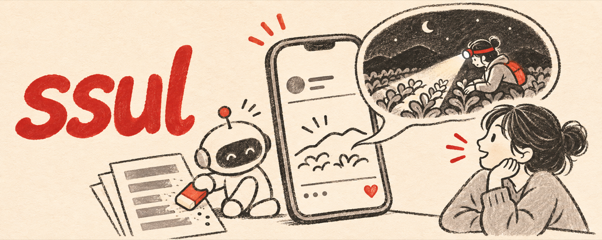

<p align="center">
  
</p>

<p align="center">
  <b>English</b> · <a href="README.ko.md">한국어</a>
</p>

# ssul

**Korean social posts that read like a real person, not like AI.**

*ssul* (썰) is Korean slang for a casual true story you tell your friends. This is an agent skill for Claude Code and Codex that writes, polishes, and audits short Korean posts for Threads, X, Instagram captions, and community boards.

It merges four kinds of open-source writing skills into one pass and settles the places where they contradict each other:

- **Hooks**: first-line formulas and the four ways a first line dies
- **Storytelling**: write the last line first, join beats with "but" and "so"
- **Korean anti-AI editing**: lesson endings, hollow reversals, 명사화, 번역투, rule-of-three lists
- **Spoken register (구어체)**: endings people actually say, no report words

## Why it exists

Running a dozen popular writing skills together on real Korean Threads posts kept producing the same failure: perfect hooks and smooth Korean that still read as AI. The cause was not style. The scene, the numbers, and the quotes were invented. No style pass can fix that.

So ssul does one thing first: it gets **real material** from you or from the conversation, and it refuses to pass off invented details as true. Then it runs the style passes.

## What it does

| Mode | You say | You get |
|---|---|---|
| Draft | a topic or rough notes | one post, plus at most 3 short notes |
| Polish | a draft + "AI 같아", "너무 무거워" | the fixed post and what changed |
| Audit | "검사해줘" | findings only, with the exact words |
| Hooks | "첫 줄만" | 3 first lines from different triggers, and a pick |

Every post goes through these checks:

1. **Truth**: every number, name, quote, and event is real, or marked `[like this]` as a placeholder
2. **Stranger test**: someone with zero context understands every line
3. **Weight test**: no setup, no fake lists, no morals
4. **Korean AI tells**, graded S1 to S3
5. **Spoken register**: no 4 identical endings in a row, no report words
6. **Platform**: under 500 characters, 0 or 1 hashtag, at most one question

## Example

Input: *"Write a post about today: I asked Claude for a Threads post and ended up installing 16 skill repos."*

```text
클로드한테 스레드 글 좀 써달라 했는데
계속 AI가 쓴 티가 나는 거예요

그래서 글 잘 쓰게 해주는 스킬을 16개나 깔아줬어요
그래도 티가 나길래
"스킬 쓴 거 맞아?" 물어보니까
"아니요, 그냥 썼습니다" ㅋㅋㅋ

다시 시켰더니 이번엔 이러더라고요
"말투는 고쳤는데, 진짜 있었던 일을 하나 알려주셔야 해요"

...그럼 그냥 내가 쓰는 거잖아
```

Every detail in it happened. That is the point.

## Install

### Claude Code (plugin)

```text
/plugin marketplace add nathankim0/ssul
/plugin install ssul@ssul
```

### Claude Code or Codex (manual)

```bash
git clone https://github.com/nathankim0/ssul.git
cp -R ssul/skills/ssul ~/.claude/skills/ssul     # Claude Code
cp -R ssul/skills/ssul ~/.codex/skills/ssul      # Codex
```

### Any agent that supports Agent Skills

```bash
npx skills add nathankim0/ssul
```

## Usage

```text
/ssul 오늘 회의에서 있었던 일로 스레드 글 하나 써줘
/ssul 이 글 AI 같은데 다듬어줘: <draft>
/ssul 검사만 해줘: <draft>
/ssul 첫 줄만 3개
```

If you have not given enough real material, ssul asks up to three short questions first. Paste two or three of your past posts and it matches your voice.

## Repository layout

```text
skills/ssul/SKILL.md              the skill
skills/ssul/references/
  conflicts.md                    14 contradictions between source skills, and the rulings
  hooks.md                        first-line triggers and killers, written in Korean
  korean-voice.md                 구어체 endings and Korean AI tells (S1 to S3)
  interview.md                    questions for getting real material
  formats.md                      scene, confession, reversal, list, question
  checklist.md                    final pass and audit format
.claude-plugin/                   Claude Code plugin and marketplace manifests
```

## Credits

ssul was built by installing and running the 16 repositories below on real Korean Threads posts. No text was copied; ideas are credited here and in [ATTRIBUTIONS.md](ATTRIBUTIONS.md).

### Hooks and short-form content

| Repository | Skills used | What ssul took |
|---|---|---|
| [vyralcontent/content-skills](https://github.com/vyralcontent/content-skills) | `viral-hooks`, `viral-short-form`, `viral-captions-and-ctas`, `viral-short-form-ideas`, `viral-tiktok-content`, `viral-instagram-reels`, `viral-youtube-shorts` | hook batches across archetypes; the promise must match the payoff |
| [artemnovitckii/content-skills](https://github.com/artemnovitckii/content-skills) | `viral-hooks`, `storytelling`, `anti-ai-writing`, `dumbify` | the four hook killers; "but / so" beats; last line first; hollow vs earned contrast |
| [rediumvex/viral-hooks-skill](https://github.com/rediumvex/viral-hooks-skill) | `viral-hooks` (100 formulas) | hook triggers grouped by psychology |

### Threads and X

| Repository | Skills used | What ssul took |
|---|---|---|
| [sergebulaev/threads-skills](https://github.com/sergebulaev/threads-skills) | `threads-post-writer`, `threads-hook-extractor`, `threads-humanizer` and 5 more | post shapes chosen by goal; story bank; never invent figures; 500-character and one-hashtag limits |
| [sergebulaev/x-skills](https://github.com/sergebulaev/x-skills) | `x-post-writer`, `x-hook-extractor` and 7 more | short-text hook shapes |

### Korean editing and spoken register

| Repository | Skills used | What ssul took |
|---|---|---|
| [Burntgogi/ai-slop-thresher](https://github.com/Burntgogi/ai-slop-thresher) | `ai-slop-thresher`, `thresh` | preserve meaning while editing Korean; never invent experience to sound human |
| [epoko77-ai/im-not-ai](https://github.com/epoko77-ai/im-not-ai) | `humanize-korean` | Korean AI-tell taxonomy; facts and numbers stay fixed |
| [amondnet/yoonmoon](https://github.com/amondnet/yoonmoon) | `humanize`, `restyle`, `proofread`, `detect`, `polish-all`, `translate-polish` | humanize, proofread, and restyle kept separate; short SNS text treated as its own case |
| [hjongc/humanizer-kr](https://github.com/hjongc/humanizer-kr) | `humanizer-kr` | match the writer's own samples |
| [leeandev/stop-slop-ko](https://github.com/leeandev/stop-slop-ko) | `stop-slop-ko`, `jasoseo` | `~함` is normal in documents but not in posts; interview for real experience before drafting |
| [NomaDamas/k-skill](https://github.com/NomaDamas/k-skill) | `korean-humanizer`, `korean-slang-writing` | severity levels for Korean AI tells; slang freshness guardrails |
| [crazyrookie777/gueoche-guard](https://github.com/crazyrookie777/gueoche-guard) | `gueoche` | the general idea of a 구어체 check (no license stated, so nothing was copied) |

### Voice, research, and marketing

| Repository | Skills used | What ssul took |
|---|---|---|
| [SorenKK/writing-signature](https://github.com/SorenKK/writing-signature) | `writing-signature` | voice measured from the writer's own texts |
| [svy04/rutter](https://github.com/svy04/rutter) | `social-media-kr`, `copy-kr` and 27 more | Korean channel context; the feed is the first line |
| [coreyhaines31/marketingskills](https://github.com/coreyhaines31/marketingskills) | `social`, `copywriting`, `marketing-psychology` and 50 more | social copy and marketing psychology background |
| [ScrapeCreators/social-media-research-skills](https://github.com/ScrapeCreators/social-media-research-skills) | `outlier-post-finder`, `trend-discovery`, `comment-mining` and 10 more | study posts that outperformed before writing |

## License

[MIT](LICENSE)
