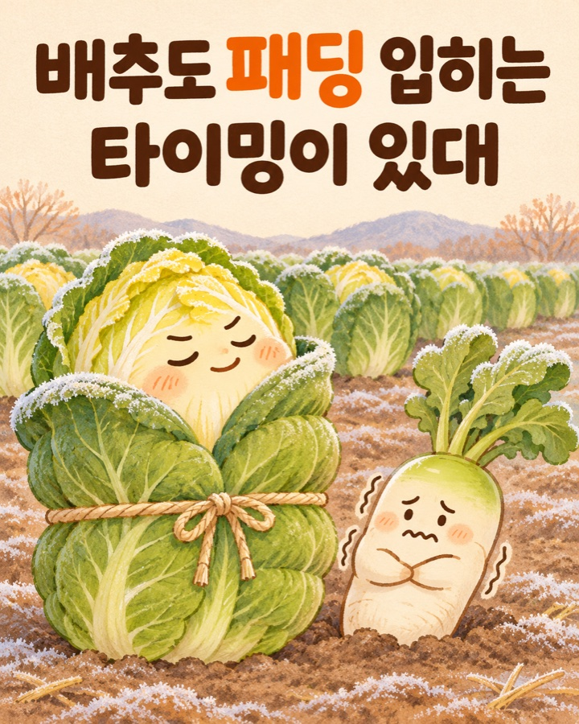

<p align="center">
  
</p>

<p align="center">
  <b>한국어</b> · <a href="README.en.md">English</a>
</p>

# ssul

**AI가 쓴 티 안 나는 한국어 SNS 글.**

*썰*은 친구한테 털어놓는 진짜 이야기입니다. ssul은 Claude Code와 Codex용 에이전트 스킬로, 스레드, X, 인스타 캡션, 커뮤니티 게시판에 올릴 한국어 글을 쓰고, 다듬고, 검사합니다.

## 왜 만들었나

글쓰기 스킬 열댓 개를 같이 돌려봐도 결과는 계속 AI 글처럼 읽혔습니다. 문체 문제가 아니라 장면, 숫자, 대사가 지어낸 것이었기 때문입니다. 그래서 ssul은 **진짜 재료**부터 받고, 문체는 그다음에 봅니다.

## 특징

- **진짜 재료 먼저**: 지어낸 내용을 사실처럼 내놓지 않습니다. 재료 없이 쓰면 글은 바로 붙여넣을 수 있게 주고, 지어낸 부분은 메모에 따로 적습니다.
- **페르소나**: 2030 스레드(`sns`), 농업 커뮤니티 농민(`farmer`), 40대 이상(`midlife`), 붙여준 글에서 뽑은 말투(`custom`). 어미, 흐름, 첫 줄, 웃음 표시가 페르소나마다 다릅니다.
- **실제 글이 기준**: 붙여준 글은 주제 참고용이어도 말투 기준이 됩니다. 내용은 가져오지 않습니다.
- **랜덤 변주**: 말투, ㅋㅋ, 길이, 시작, 끝맺음을 실제 난수로 뽑습니다(`roll.py`). 농민 글은 형식과 주제까지 뽑고, `roughen.py`가 띄어쓰기, 표기, 줄바꿈을 실제 글처럼 거칠게 만듭니다.
- **AI 티 점검**: 교훈형 마무리, 번역투, 명사화, 이모지 같은 티는 지우고, 반대로 실제 글보다 너무 깔끔한 것도 잡습니다.
- **광고 표시**: 대가를 받은 글은 공정위 기준대로 첫 부분에 밝힙니다.

## 설치

```text
/plugin marketplace add nathankim0/ssul
/plugin install ssul@ssul
```

직접 복사하거나 다른 에이전트에서 쓰려면:

```bash
git clone https://github.com/nathankim0/ssul.git
cp -R ssul/skills/ssul ~/.claude/skills/ssul     # Claude Code
cp -R ssul/skills/ssul ~/.codex/skills/ssul      # Codex
npx skills add nathankim0/ssul                    # Agent Skills 지원 에이전트
```

Python 3가 있으면 랜덤 변주를 씁니다(표준 라이브러리만). 이미지 모드는 [Codex CLI](https://github.com/openai/codex) 이미지 생성이나 `OPENAI_API_KEY`가 필요합니다.

## 사용법

```text
/ssul 오늘 회의에서 있었던 일로 스레드 글 써줘
/ssul 농민 말투로 커뮤니티에 올릴 글 3개 써줘
/ssul 이 인기글들 말투로 써줘: <글들> <메모>
/ssul 이 글 AI 같은데 다듬어줘: <초안>
/ssul 검사만 해줘: <초안>
/ssul 이 글로 이미지 만들어줘
/ssul 다시 굴려
```

그 밖에 첫 줄만, 답글, 블로그를 스레드로, 연재 스레드, 주간 계획, 프로필, 릴스 대본도 됩니다. 예전 글을 붙여주면 말투를 맞추고, 동의하면 `~/.ssul/`에 저장해 다음부터 묻지 않습니다.

## 예시

### 1. 정보 글, 스레드

입력: *"마늘 언제 덮는지 글."*

```text
마늘 너무 일찍 덮으면 오히려 얼 수 있대
싹이 겨울 오기 전에 웃자라서 그렇다고
11월 중순에서 하순쯤 덮는 게 좋대
다들 언제 덮어?
```

사실 출처: 이천시농업기술센터.

### 2. 내 이야기, 스레드 호칭

입력: *"오늘 오픈소스 스킬 3개 만들었는데 별이 다 0개야."*

```text
스친이들 나 오늘 스레드 글 하나 쓰려다가 오픈소스를 3개 만들어버렸어..
깃허브 올려놓고 보니까 별이 셋 다 0개 ㅋㅋ
이게 맞냐고
```

별 개수는 2026-11-06에 확인한 실제 값입니다.

### 3. 커뮤니티 병맛 글과 후킹 이미지

입력: *"커뮤니티에 올릴 병맛 농사 글."* 그다음 *"이미지 만들어줘."*

```text
배추도 패딩 입히는 타이밍이 있대 ㅋㅋㅋ
겉잎 끈으로 묶어주는 게 배추 패딩인데 너무 일찍 입히면 답답해서 덜 큰대...
그래서 영하 예보 뜰 때 입히는 거래
무는 0도만 돼도 얼어서 그 전에 캐야 된대
```

<p align="center">
  
</p>

사실 출처: 서울시 농업기술센터. 이미지는 AI 생성이라 올릴 때 플랫폼의 AI 표시를 켜야 합니다.

### 4. 농민 페르소나, 질문 글

입력: *"농민 말투로 농업 커뮤니티에 올릴 글, 11월 이야기로."* 실제 재료 없이 돌린 테스트라 지역, 작물, 숫자는 모두 지어낸 것이고, ssul도 메모에 그렇게 적었습니다.

```text
안녕하세요.
강원 홍천에서 단동 비닐하우스 세 동에 시금치 키우고 있습니다.

이번 주말에 눈이 10cm 정도 온다는데 지은 지 15년 넘은 하우스라 불안합니다

지금 버팀목을 세워두는 게 나을지 눈 올 때 밤새 쓸어내리는 게 나을지 궁금합니다
작년엔 밤새 쓸다가 감기만 얻었네요 ㅎㅎ


다들 눈 피해 없으시길 바랍니다
```

### 5. 광고 표시가 필요한 글 다듬기

입력(테스트용 가상 초안):

```text
이번에 OO브랜드에서 보내주셨어요! 써보니까 진짜 좋아서 할께요 추천. 7일 이내에만 무료 반품 가능하대요 ㅋㅋ 체험단으로 받은거에요 #OO브랜드
```

결과:

```text
[광고] OO브랜드에서 제품을 무료로 제공받았어요

써보니까 진짜 좋아서 추천할게요
7일 이내에만 무료 반품 가능하대요 ㅋㅋ
```

"보내주셨어요", "체험단"은 공정위 기준 광고 표시가 아니라서 첫 줄에 분명히 넣었습니다. 반품 기한을 좁히는 "이내에만"은 그대로 두고, "할께요"만 고쳤습니다.

## 구성

```text
skills/ssul/SKILL.md          스킬 본문
skills/ssul/references/       말투, 페르소나, 형식, 훅, AI 티, 광고 표시 등 필요할 때 읽는 문서
skills/ssul/scripts/          roll.py (랜덤 설정), roughen.py (농민, 중장년 글 거칠게)
.claude-plugin/               플러그인 매니페스트
```

## 참고한 프로젝트

오픈소스 글쓰기 스킬 16개를 실제 한국어 글에 돌려보며 만들었고, 문장은 가져오지 않았습니다. 저장소별로 무엇을 가져왔는지는 [ATTRIBUTIONS.md](ATTRIBUTIONS.md)에 있습니다.

## 라이선스

[MIT](LICENSE)
